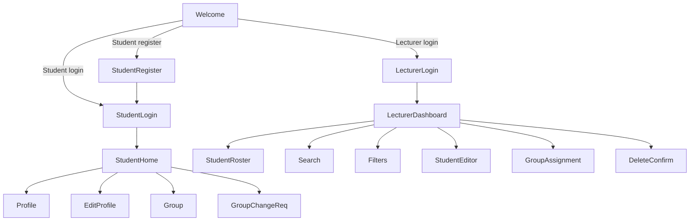

**Navigation flow description**
- The UI presents the screens in the order above.
- Back navigation follows the reverse arrows; the Architecture team will wire it with the chosen navigation framework.
- All destination names (e.g., `StudentLogin`, `StudentHome`) are *logical* identifiers; concrete fragment/activity class names will be defined later.
