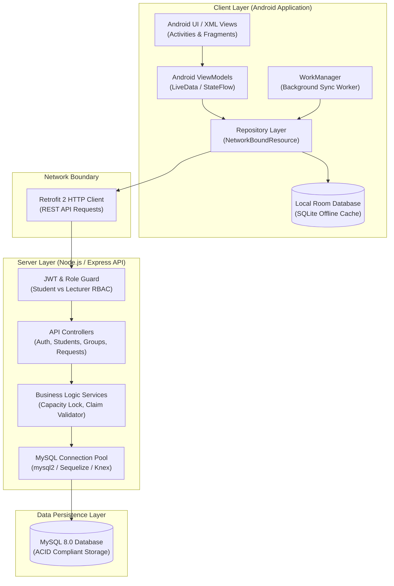

# UniConnect — Part 1: System Architecture, Planning & Agent Handover

> **Document Version:** 1.0.0  
> **Target Audience:** Backend Developers, Database Engineers, Android Architecture Team, AI Coding Agents  
> **Project Context:** 15-Member University Academic Development Project — Student Registration & Laboratory Group Management System

---

## 1. Executive Summary & Project Mission

**UniConnect** is a native Android and client-server academic management platform designed for universities to manage student registrations, programme allocations (CS, IT, DS), laboratory group distribution (`G01`–`G04`), occupancy limits (maximum 15 students per lab group), and student transfer requests.

The project is developed across five specialized sub-teams:
1. **Planning Team:** Overall project schedule, requirements management, and sprint checkpoints.
2. **UI/UX Team:** Native Android XML/Java interface, Material Components, design system, touch targets, accessibility (TalkBack, 200% text size), navigation flows, and UI state containers *(Completed in Frontend Phases 1–5)*.
3. **Local Storage and Synchronization Team:** Android Room DB SQLite persistence, offline cache, conflict detection, background sync via `WorkManager`.
4. **Backend and Database / Android Architecture Team:** Node.js/Express REST API, MySQL relational database, JWT authentication, server-authoritative business rules, Retrofit client, and ViewModel/Repository integration.
5. **Testing and Integration Team:** Unit testing, API regression tests, UI accessibility checks, load testing, and end-to-end integration validation.

---

## 2. High-Level System Architecture

The UniConnect system follows a **Local-First, Server-Authoritative Architecture**:
- **Clients (Android Apps):** Run on students' and lecturers' devices. They communicate with the REST API using JSON over HTTPS, cache all relevant records locally in a Room database, and queue outgoing mutations when offline.
- **Backend Service (Node.js + Express):** Stateless RESTful API service providing authentication, RBAC authorization, CRUD operations, capacity locking, and sync endpoints.
- **Relational Database (MySQL 8.0+):** Persistent source of truth. Stores students, lecturers, claim verification codes, lab group capacities, schedules, and group change audit logs.



---

## 3. Strict Boundary Rules & System Invariants

These invariants are established in `INSTRUCTIONS.md` and MUST be respected by the backend developer:

1. **Server Authority (§5, §25):** The backend database is the *sole authority* on group capacity (maximum 15 students per group) and student uniqueness. The Android UI displays cached counts but never assumes local authority.
2. **Student Number Format (§13.2):** Exactly 9 numeric digits (e.g. `202400123`). Leading zeroes must be preserved (stored as `VARCHAR(9)` or `CHAR(9)`, NOT an integer).
3. **Claim Codes (§13.2):** Department-issued claim codes verify that the registering student is authorized to claim their student account and enroll in lab groups.
4. **Programmes (§13.2):** Exactly three valid academic programmes:
   - `CS` — Computer Science
   - `IT` — Information Technology
   - `DS` — Data Science
5. **Lab Groups (§13.5, §14.7, §37):** Four laboratory cohorts:
   - `G01`: Monday 08:00 – 10:00 (Lab 3B - Systems Lab, Prof. Davis)
   - `G02`: Tuesday 14:00 – 16:00 (Lab 1A - Main Lab, Dr. A. Banda)
   - `G03`: Wednesday 10:00 – 12:00 (Lab 2C - Software Lab, Dr. Phiri)
   - `G04`: Thursday 16:00 – 18:00 (Lab 3B - Networking Lab, Prof. Davis)
   - Max capacity per group: **15 students**. Groups at 15/15 must reject new standard assignments unless overridden by a lecturer.
6. **Passwords & Security (§39, §40):** Passwords must be hashed with `bcrypt` (salt rounds ≥ 10). Plain text passwords must never be stored or returned in any API response.
7. **Offline Sync & Soft Deletes (§17, §18):** Deletions must be handled with a soft-delete column (`is_deleted = TRUE` or `deleted_at = NOW()`) and revision versions (`version INT`) so that offline mobile clients can detect deletions and sync conflicts gracefully.

---

## 4. Master Prompt for AI Agent on the Backend PC

Copy and paste the prompt below into the AI coding assistant (Cursor, Antigravity, Claude Code, or ChatGPT) on the PC dedicated to building the backend:

```markdown
=== AI AGENT SYSTEM PROMPT: UNICONNECT BACKEND DEVELOPER ===

You are an expert Backend & Database Architect building the production REST API and MySQL database for "UniConnect" — an academic student registration and laboratory group management application.

PROJECT CONTEXT & REPOSITORY ASSETS:
The Android UI/UX has already been built in native Java/XML and strictly follows the data contracts defined in the project specifications.
Your responsibility is to implement:
1. A clean, modular Node.js + Express REST API (JavaScript ES6+ or TypeScript).
2. A relational MySQL 8.0 schema with tables, foreign keys, constraints, and seed data.
3. Secure authentication (bcrypt password hashing, JWT tokens with student/lecturer roles).
4. Business logic enforcement (student number 9 digits, claim code validation, max 15 students per lab group with race condition prevention, transfer request workflows).
5. Offline delta synchronization endpoints (/api/sync/pull and /api/sync/push).

TECH STACK:
- Runtime: Node.js (v18+ or v20+ LTS)
- Framework: Express.js (or Fastify)
- Database: MySQL 8.0 (using mysql2 with connection pooling, or Knex / Prisma)
- Authentication: jsonwebtoken + bcryptjs
- Validation: express-validator or Zod
- Environment: dotenv

STRICT RULES:
- Never hardcode database credentials. Use .env files with .env.example provided.
- Student numbers must be treated as strings (VARCHAR(9)) to preserve leading zeros.
- Enforce the 15-student hard limit on lab groups during assignment and registration.
- Ensure API response formats exactly match the JSON contracts documented in BACKEND_API_SPECIFICATION.md.
- Follow REST conventions: proper HTTP status codes (200, 201, 400, 401, 403, 404, 409, 500).
- Include comprehensive seed scripts with realistic test data matching the Android UI mock screens (e.g. Dr. A. Banda, Peculiar Banda, G01-G04 cohorts).

Please review PART_2_BACKEND_API_SPECIFICATION.md and PART_3_DATABASE_SCHEMA_AND_MIGRATIONS.md before writing code, and scaffold the project cleanly.
```

---

## 5. Phased Backend Implementation Roadmap

To avoid building too much at once and to facilitate verification, the backend developer should execute the work across 5 structured phases:

| Phase | Milestone | Deliverables | Verification Criteria |
| :--- | :--- | :--- | :--- |
| **Phase B1** | **Database & Environment Setup** | MySQL DDL schema, migrations, connection pool, `.env` config, seed data script | MySQL database running; seed data inserts cleanly without foreign key errors. |
| **Phase B2** | **Authentication & Security** | Student register, student login, lecturer login, JWT middleware, claim code validator | Postman/curl tests register a new student, verify claim code, login, and return JWT. |
| **Phase B3** | **Student & Group Management** | Student profile endpoint, edit profile, lab group listing, occupancy counters, 15-cap logic | Capacity checks prevent enrolling 16th student in group; profile updates succeed. |
| **Phase B4** | **Lecturer Operations & Transfer Requests** | Lecturer student roster (search, filter, pagination), student editor, transfer request workflows | Lecturer can approve a pending transfer request; group counts update atomically. |
| **Phase B5** | **Sync & Conflict Endpoints** | `/api/sync/pull` and `/api/sync/push` endpoints with delta timestamps and conflict detection | Client can send batch mutations offline; conflicts flag `CONFLICT` payload. |
