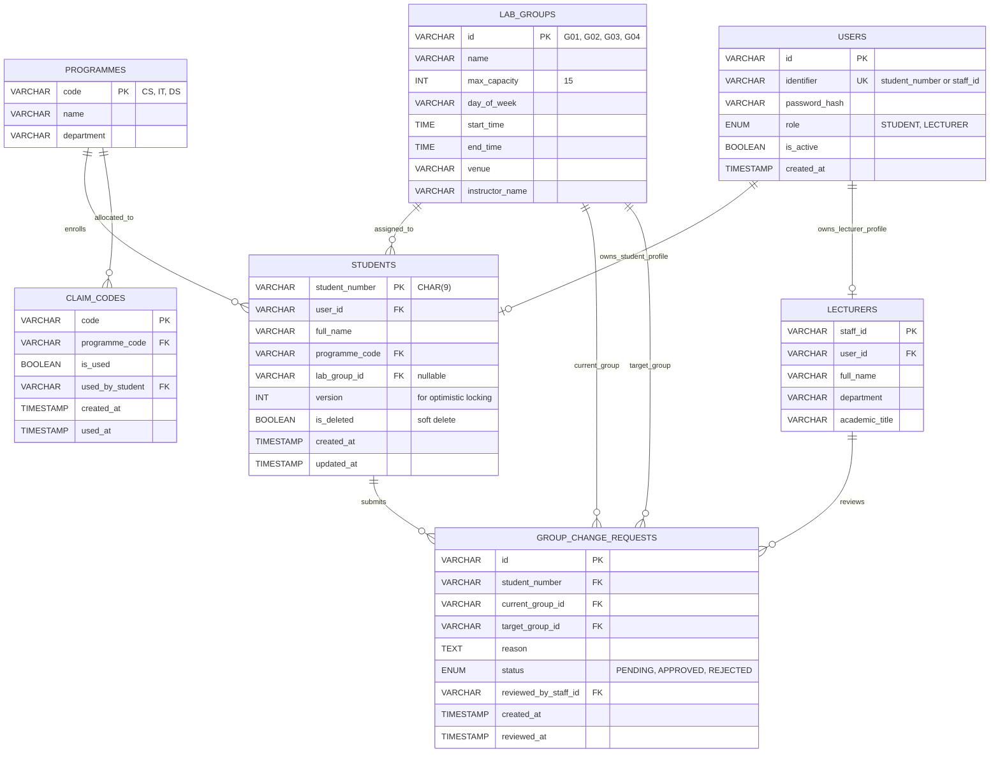

# UniConnect — Part 3: Database Schema, Relational Model & Migrations

> **Target Database Engine:** MySQL 8.0+ (InnoDB Storage Engine)  
> **Character Set:** `utf8mb4`  
> **Collation:** `utf8mb4_unicode_ci`  
> **ACID Compliance:** Strict transactions required for group capacity locking.

---

## 1. Entity-Relationship Diagram (ERD)



---

## 2. Complete MySQL DDL Migration Script

The script below sets up all tables, foreign keys, unique indices, and check constraints.

```sql
-- ============================================================================
-- UNICONNECT DATABASE SCHEMA DDL MIGRATION (MySQL 8.0+)
-- ============================================================================

CREATE DATABASE IF NOT EXISTS uniconnect_db
  CHARACTER SET utf8mb4
  COLLATE utf8mb4_unicode_ci;

USE uniconnect_db;

-- 1. USERS TABLE (Authentication credentials & RBAC)
CREATE TABLE IF NOT EXISTS users (
    id VARCHAR(36) PRIMARY KEY,
    identifier VARCHAR(50) NOT NULL UNIQUE, -- student_number or staff_id
    password_hash VARCHAR(255) NOT NULL,
    role ENUM('STUDENT', 'LECTURER') NOT NULL,
    is_active BOOLEAN NOT NULL DEFAULT TRUE,
    created_at TIMESTAMP NOT NULL DEFAULT CURRENT_TIMESTAMP,
    updated_at TIMESTAMP NOT NULL DEFAULT CURRENT_TIMESTAMP ON UPDATE CURRENT_TIMESTAMP,
    INDEX idx_user_identifier (identifier)
) ENGINE=InnoDB;

-- 2. PROGRAMMES TABLE (CS, IT, DS)
CREATE TABLE IF NOT EXISTS programmes (
    code VARCHAR(10) PRIMARY KEY, -- 'CS', 'IT', 'DS'
    name VARCHAR(100) NOT NULL,
    department VARCHAR(100) NOT NULL DEFAULT 'Computer Science & IT'
) ENGINE=InnoDB;

-- 3. LAB_GROUPS TABLE (G01–G04, capacity 15, schedule, venue)
CREATE TABLE IF NOT EXISTS lab_groups (
    id VARCHAR(10) PRIMARY KEY, -- 'G01', 'G02', 'G03', 'G04'
    name VARCHAR(50) NOT NULL,
    max_capacity INT NOT NULL DEFAULT 15,
    day_of_week VARCHAR(15) NOT NULL,
    start_time TIME NOT NULL,
    end_time TIME NOT NULL,
    venue VARCHAR(100) NOT NULL,
    instructor_name VARCHAR(100) NOT NULL,
    CONSTRAINT chk_capacity CHECK (max_capacity > 0)
) ENGINE=InnoDB;

-- 4. STUDENTS TABLE (Preserves 9-digit numbers, programme, group)
CREATE TABLE IF NOT EXISTS students (
    student_number CHAR(9) PRIMARY KEY, -- Exactly 9 digits, preserves leading zeros
    user_id VARCHAR(36) NULL,
    full_name VARCHAR(100) NOT NULL,
    programme_code VARCHAR(10) NOT NULL,
    lab_group_id VARCHAR(10) NULL,
    version INT NOT NULL DEFAULT 1, -- For optimistic concurrency & offline conflict detection
    is_deleted BOOLEAN NOT NULL DEFAULT FALSE, -- Soft delete for offline sync (§18)
    created_at TIMESTAMP NOT NULL DEFAULT CURRENT_TIMESTAMP,
    updated_at TIMESTAMP NOT NULL DEFAULT CURRENT_TIMESTAMP ON UPDATE CURRENT_TIMESTAMP,
    CONSTRAINT fk_students_user FOREIGN KEY (user_id) REFERENCES users(id) ON DELETE SET NULL,
    CONSTRAINT fk_students_programme FOREIGN KEY (programme_code) REFERENCES programmes(code) ON UPDATE CASCADE,
    CONSTRAINT fk_students_group FOREIGN KEY (lab_group_id) REFERENCES lab_groups(id) ON DELETE SET NULL,
    INDEX idx_students_name (full_name),
    INDEX idx_students_group (lab_group_id),
    INDEX idx_students_updated (updated_at)
) ENGINE=InnoDB;

-- 5. LECTURERS TABLE (Staff profile)
CREATE TABLE IF NOT EXISTS lecturers (
    staff_id VARCHAR(50) PRIMARY KEY,
    user_id VARCHAR(36) NOT NULL UNIQUE,
    full_name VARCHAR(100) NOT NULL,
    department VARCHAR(100) NOT NULL,
    academic_title VARCHAR(50) NOT NULL DEFAULT 'Lecturer',
    created_at TIMESTAMP NOT NULL DEFAULT CURRENT_TIMESTAMP,
    CONSTRAINT fk_lecturers_user FOREIGN KEY (user_id) REFERENCES users(id) ON DELETE CASCADE
) ENGINE=InnoDB;

-- 6. CLAIM_CODES TABLE (Department verification codes §13.2)
CREATE TABLE IF NOT EXISTS claim_codes (
    code VARCHAR(50) PRIMARY KEY,
    programme_code VARCHAR(10) NOT NULL,
    is_used BOOLEAN NOT NULL DEFAULT FALSE,
    used_by_student CHAR(9) NULL,
    created_at TIMESTAMP NOT NULL DEFAULT CURRENT_TIMESTAMP,
    used_at TIMESTAMP NULL,
    CONSTRAINT fk_claims_programme FOREIGN KEY (programme_code) REFERENCES programmes(code) ON UPDATE CASCADE,
    CONSTRAINT fk_claims_student FOREIGN KEY (used_by_student) REFERENCES students(student_number) ON DELETE SET NULL
) ENGINE=InnoDB;

-- 7. GROUP_CHANGE_REQUESTS TABLE (Student transfer workflow §13.7 & §14.7)
CREATE TABLE IF NOT EXISTS group_change_requests (
    id VARCHAR(36) PRIMARY KEY,
    student_number CHAR(9) NOT NULL,
    current_group_id VARCHAR(10) NOT NULL,
    target_group_id VARCHAR(10) NOT NULL,
    reason TEXT NOT NULL,
    status ENUM('PENDING', 'APPROVED', 'REJECTED') NOT NULL DEFAULT 'PENDING',
    reviewed_by_staff_id VARCHAR(50) NULL,
    created_at TIMESTAMP NOT NULL DEFAULT CURRENT_TIMESTAMP,
    reviewed_at TIMESTAMP NULL,
    CONSTRAINT fk_req_student FOREIGN KEY (student_number) REFERENCES students(student_number) ON DELETE CASCADE,
    CONSTRAINT fk_req_current_group FOREIGN KEY (current_group_id) REFERENCES lab_groups(id),
    CONSTRAINT fk_req_target_group FOREIGN KEY (target_group_id) REFERENCES lab_groups(id),
    CONSTRAINT fk_req_lecturer FOREIGN KEY (reviewed_by_staff_id) REFERENCES lecturers(staff_id) ON DELETE SET NULL,
    INDEX idx_req_status (status),
    INDEX idx_req_student (student_number)
) ENGINE=InnoDB;
```

---

## 3. Seed Data SQL Script

This script initializes all programmes, lab cohorts, default staff credentials, claim codes, and the student accounts used during UI verification.

```sql
-- ============================================================================
-- UNICONNECT SEED DATA
-- Passwords:
--   Students: 'Password123!' (bcrypt hash below: $2a$10$wE8qL05jWl5eJc...)
--   Lecturers: 'LecturerPass2026!'
-- ============================================================================

USE uniconnect_db;

-- 1. Insert Programmes
INSERT INTO programmes (code, name, department) VALUES
('CS', 'Computer Science', 'Computer Science & IT'),
('IT', 'Information Technology', 'Computer Science & IT'),
('DS', 'Data Science', 'Computer Science & IT')
ON DUPLICATE KEY UPDATE name=VALUES(name);

-- 2. Insert Lab Groups with Venues & Instructors
INSERT INTO lab_groups (id, name, max_capacity, day_of_week, start_time, end_time, venue, instructor_name) VALUES
('G01', 'Lab Group 01', 15, 'Monday',    '08:00:00', '10:00:00', 'Lab 3B (Systems Lab)',   'Prof. Davis'),
('G02', 'Lab Group 02', 15, 'Tuesday',   '14:00:00', '16:00:00', 'Lab 1A (Main Lab)',      'Dr. A. Banda'),
('G03', 'Lab Group 03', 15, 'Wednesday', '10:00:00', '12:00:00', 'Lab 2C (Software Lab)',  'Dr. Phiri'),
('G04', 'Lab Group 04', 15, 'Thursday',  '16:00:00', '18:00:00', 'Lab 3B (Networking Lab)','Prof. Davis')
ON DUPLICATE KEY UPDATE venue=VALUES(venue);

-- 3. Insert Department Claim Codes
INSERT INTO claim_codes (code, programme_code, is_used) VALUES
('CLAIM-CS-2024', 'CS', FALSE),
('CLAIM-IT-2024', 'IT', FALSE),
('CLAIM-DS-2024', 'DS', FALSE),
('CLAIM-TEST-99', 'CS', FALSE)
ON DUPLICATE KEY UPDATE programme_code=VALUES(programme_code);

-- 4. Insert Lecturer Account (Dr. A. Banda)
-- Password: 'LecturerPass2026!' -> bcrypt hash
INSERT INTO users (id, identifier, password_hash, role) VALUES
('usr-lecturer-001', 'STF-2024-88', '$2b$10$EixZaYVK1fsbw1ZfbX3OXePaWxn96p36WQoeG6Lruj3vjPGga31lW', 'LECTURER')
ON DUPLICATE KEY UPDATE password_hash=VALUES(password_hash);

INSERT INTO lecturers (staff_id, user_id, full_name, department, academic_title) VALUES
('STF-2024-88', 'usr-lecturer-001', 'Dr. A. Banda', 'Computer Science & IT', 'Senior Lab Coordinator')
ON DUPLICATE KEY UPDATE full_name=VALUES(full_name);

-- 5. Insert Primary Student (Peculiar Banda)
-- Password: 'Password123!' -> bcrypt hash
INSERT INTO users (id, identifier, password_hash, role) VALUES
('usr-student-001', '202400123', '$2b$10$wT5H8lUeA7q5s4t.oY0BFe6VqB4b5I8M8vR3X9eW9z0v2N9wZ5y5.', 'STUDENT')
ON DUPLICATE KEY UPDATE password_hash=VALUES(password_hash);

INSERT INTO students (student_number, user_id, full_name, programme_code, lab_group_id, version) VALUES
('202400123', 'usr-student-001', 'Peculiar Banda', 'CS', 'G01', 1)
ON DUPLICATE KEY UPDATE full_name=VALUES(full_name);

-- 6. Insert Cohort Mock Students (Matching Roster in UI)
INSERT INTO students (student_number, user_id, full_name, programme_code, lab_group_id, version) VALUES
('202400456', NULL, 'Amara Dlamini', 'IT', 'G01', 1),
('202400789', NULL, 'Tendai Moyo',   'DS', 'G02', 1),
('202401011', NULL, 'Nkosi Zulu',    'CS', 'G02', 1),
('202401234', NULL, 'Fatima Patel',  'IT', 'G03', 1),
('202401567', NULL, 'Sipho Ndlovu',  'DS', 'G03', 1),
('202401890', NULL, 'Grace Mwangi',  'CS', 'G04', 1),
('202402123', NULL, 'Chidi Okafor',  'IT', NULL,  1) -- Unassigned
ON DUPLICATE KEY UPDATE full_name=VALUES(full_name);

-- 7. Insert Initial Transfer Requests (Matching Lecturer Tab 4)
INSERT INTO group_change_requests (id, student_number, current_group_id, target_group_id, reason, status) VALUES
('REQ-1001', '202400123', 'G01', 'G02', 'Timetable conflict with CS302 Advanced Algorithms lecture on Monday mornings.', 'PENDING'),
('REQ-1002', '202400789', 'G02', 'G03', 'Medical appointment scheduled weekly during Tuesday afternoon slot.', 'PENDING')
ON DUPLICATE KEY UPDATE reason=VALUES(reason);
```

---

## 4. Race Condition & Capacity Locking Strategy

When enrolling students or approving transfers, the server must prevent two concurrent requests from filling the 15th seat simultaneously. Use MySQL row-level locking (`SELECT ... FOR UPDATE`):

```sql
START TRANSACTION;

-- 1. Check current capacity under an exclusive write lock
SELECT COUNT(*) AS enrolled_count, g.max_capacity 
FROM students s
JOIN lab_groups g ON g.id = 'G02'
WHERE s.lab_group_id = 'G02' AND s.is_deleted = FALSE
FOR UPDATE;

-- 2. In Node.js: if enrolled_count >= max_capacity, ROLLBACK and return 409 GROUP_FULL.

-- 3. Otherwise, assign student:
UPDATE students 
SET lab_group_id = 'G02', version = version + 1 
WHERE student_number = '202400123';

-- 4. Mark change request as approved:
UPDATE group_change_requests 
SET status = 'APPROVED', reviewed_at = NOW() 
WHERE id = 'REQ-1001';

COMMIT;
```
